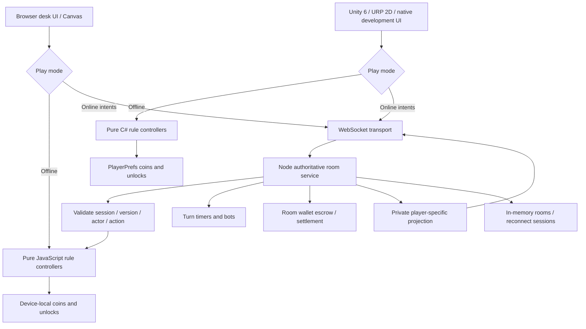
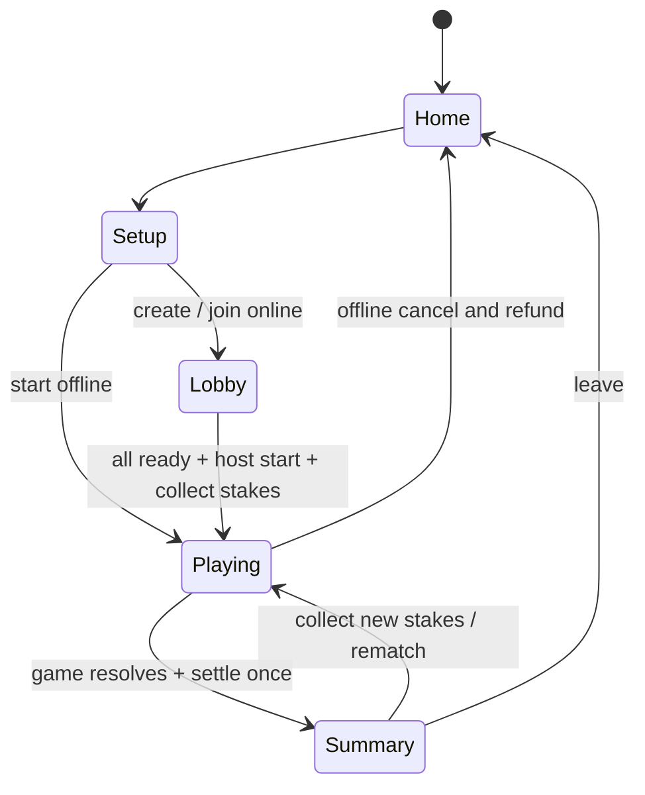
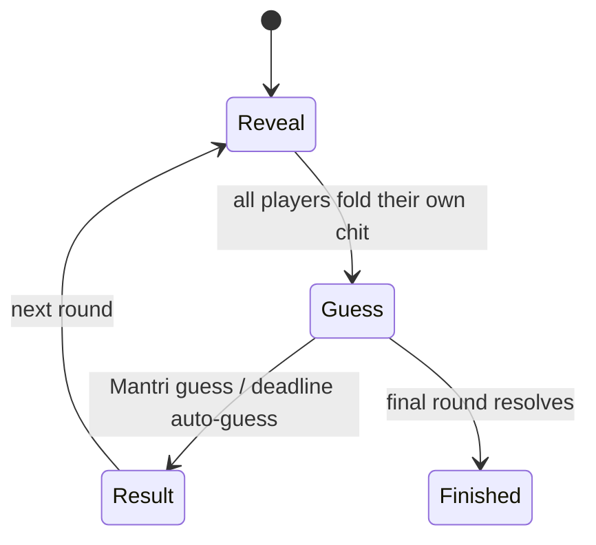

# System architecture

## Runtime diagram



The wire authority uses `shared/core.js`. The Unity rules implement the same geometry, scoring, and economy rules for offline play. The Unity online client does not simulate or send authoritative state: it renders server snapshots and submits intents. Random seeds/trajectories do not need to match between separate offline matches. No Unity physics simulation determines competitive results.

## Folder structure

```text
backbenchers/
├── README.md
├── package.json, package-lock.json
├── .env.example, .gitignore
├── .github/workflows/ci.yml
├── shared/core.js                 pure games, bots, geometry, projections, escrow
├── server/index.js                HTTP assets, WebSocket rooms, authority, timers
├── web/
│   ├── index.html                 accessible shell and privacy curtain
│   ├── style.css                  responsive stationery visual system
│   └── app.js                     hub, setup, lobby, Canvas, locker, audio, input
├── dist/backbencher.html           checked-in, standalone offline game
├── scripts/build.js                reproducible single-file bundler
├── tests/
│   ├── core.test.js               rules and payouts
│   ├── server.test.js             real socket sessions and authorization
│   ├── browser.cjs                mouse/touch-sized UI and offline smoke checks
│   └── dotnet/                    executable tests for Unity's pure C# core
├── unity/
│   ├── Assets/Backbencher/
│   │   ├── Scripts/
│   │   │   ├── Models.cs
│   │   │   ├── GameRules.cs        GameRules, Geometry, PenRocketRules,
│   │   │   │                     DotsRules, RmcsRules, BotController
│   │   │   ├── Economy.cs
│   │   │   ├── NetworkSyncManager.cs
│   │   │   └── BackbenchApp.cs
│   │   └── Editor/ProjectSetup.cs  scene + URP creation, Android build command
│   ├── Packages/manifest.json
│   └── ProjectSettings/ProjectVersion.txt
└── docs/                          architecture, protocol/schema, rules, status, brief
```

The scene and renderer assets are created in Unity through the setup menu. Runtime bootstrap also creates the app when entering Play in an empty scene. UI is separated from pure rule classes so a production Canvas/UI Toolkit or sprite presentation can replace the native IMGUI harness.

## State machines



RMCS uses a nested round state:



- Dots turns are 6 seconds, RMCS guesses 15 seconds. Pen turns and online private reveals get 30 seconds.
- An offline privacy curtain pauses the local clock; a server deadline never pauses for a client overlay.
- Each ordinary move or phase transition resets its clock. Side bets and swaps do not extend a deadline.
- Bots act after roughly 900 ms online or 1,050 ms locally. Missing players use the same bot policy.
- A completed box earns a new timed turn. A single edge can close multiple boxes.

## Authority and privacy

Clients identify with a cryptographically random bearer reconnect token obtained from `hello`. The server binds that token to a seat and ignores any proposed actor identity inside an action. Room codes locate rooms; they are not user authentication. Each accepted update increments the room version. An intent must name the current version to prevent duplicate/replayed moves from applying twice.

During RMCS reveal, `roles` is all null; during guessing it contains only Raja and Mantri. Each individual snapshot includes `myRole` for the recipient. Other hidden roles are absent, rather than encrypted with a shared key shipped in every client. No client can decrypt information it never received. Finished round roles are public by design. Use WSS for remote transport confidentiality.

Pass-and-play intentionally has the complete role array on the shared device. Its curtain protects against casual looking, not a player inspecting memory/devtools. Native offline follows the same trust model.

## Economy

`collect` checks the full roster before mutation, then atomically debits each room/player wallet into one escrow. `settle` validates recipients, conserves the pot, splits ties in seat order for integer remainders, refunds a no-survivor result, and rejects a second payout. A double-stakes rematch is a fresh escrow after everyone is ready; it does not retroactively alter the previous pot.

Offline host coins and unlocked pens persist locally. Guest wallets persist only for the current match/rematch session. Online wallets start with 1,000 per joining player and live in the room. Daily rewards and progression are prototype device-local features, not account-backed entitlements.

## Deployment shape

One Node process serves the UI and all rooms. `PORT`, `HOST`, and `ALLOWED_ORIGIN` are environment options. Message payloads are capped at 8 KiB and connections are throttled at 30 incoming messages/second. Server-generated snapshots can be larger. Rooms cap at six seats and the process caps at 200 rooms / 5,000 sessions. Inactive rooms and sessions are reclaimed. These limits are guardrails, not a completed anti-abuse or availability system.

For production: externalize room/session persistence, add real identity and account-backed ledgers, configure HTTPS/WSS behind a proxy, add per-IP connection controls and telemetry, test service restart/recovery, and load-test before promising latency or capacity. A multi-node deployment needs sticky rooms or shared authority ownership; simply adding replicas will not synchronize state.
